# Large-scale electric vehicle order discharge and load forecast based on Monte Carlo method (Python & Matlab implementation)

Contents
0 Overview
1. Monte Carlo Simulation Method Introduction
2. Methods for Predicting the Charging Load of Large-Scale Electric Vehicles
3 Complete Code
0 Overview for the research of this paper. Based on the distribution function and setting parameters of different applications, Monte Carlo method is adopted. Daily driving distance for various purposes of electric vehicles. Starting charging time probability distribution parameters are randomly sampled. Calculate the initial charge state and the charging time required. And then predict the charging load curve of each type of electric vehicle. Finally, the total charging load curve is obtained by superposing the charging load curves of various electric vehicles.
1. Introduction to Monte Carlo Simulation Method The most important feature of this method is that it is a method based on the theory of probability statistics. With the development of science and technology and the invention of electronic computers, The Monte Carlo method, with its advantages in describing the development characteristics of physics and the process of physical experiments. It has been widely used in various fields.
2. The method for predicting the charging load of large-scale electric vehicles is based on research on the charging influencing factors of various types of electric vehicles, which includes basic parameters such as the distribution of starting charging capacity and starting time, as shown in Table 1.
​​  
This table provides the parameters needed for the establishment of charging load prediction calculations for various purposes of electric vehicles:
Electric buses generally undergo regular charging, with the daily mileage and starting charging time following a uniform distribution.
Electric taxis generally undergo rapid charging, with daily mileage following a uniform distribution, and the starting charging time follows a normal random distribution.
Electric private vehicles have two charging modes: regular charging and fast charging. The daily driving distance follows an exponential distribution, while the starting charging time follows a normal random distribution. During regular and fast charging, the charging power for different types of electric vehicles varies. The charging power for electric buses is approximately five times that of electric private cars, and for electric taxis, it is approximately twice that of electric private cars.
After the study of principle and model, it is assumed that all electric vehicles are in an unordered charging state. The specific calculation method is as follows:
(1) Based on the predicted ownership of electric vehicles in various uses in Beijing, the market size for electric vehicles is determined as shown in Table 2.
​  
(2) Based on the distribution functions and set parameters for different purposes of electric vehicles, as shown in Table 1, Monte Carlo simulation methods are employed for simulation. The date type, starting charging time of electric vehicles, and daily driving mileage are randomly selected.
(3) Calculate the initial charge state and the required charging time for the vehicle. The remaining battery capacity of an electric vehicle directly affects the charging time required for the vehicle. For the charging time of an electric vehicle, this article uses the State of Charge (SOC) of the electric vehicle's power battery to calculate it. Assuming that the consumed electricity is proportional to the distance traveled, where ​ represents the distance traveled and ​ represents the maximum range in electric mode. Here, it is assumed that the consumption of electricity per kilometer is the same for each type of electric vehicle, and the remaining battery capacity at the end of the last trip is calculated by the following formula:
​  
In the formula, SOC1 represents the battery's state of charge at the time of completing charging, and SOC2 represents the battery's state of charge at the time of the previous completion of charging.
The time required for electric vehicle charging, T, can be calculated by taking into account the battery capacity C, the starting charge state SOC, and the charging power P.
Okay, the specific formula is as follows:
​  
(4) Calculate the total charging load for a certain type of electric vehicle at each ith charging load calculation point. This paper calculates daily as 1440 minutes, calculating the charging load every 15 minutes, totaling 96 charging load calculation points. It predicts the charging loads for electric vehicles in various uses in Beijing and obtains the charging loads for electric vehicles in various uses. The prediction calculation method for the charging load of a certain type of electric vehicle is as follows:
​  
The total charging load of a certain type of electric vehicle at the i-th charging load calculation point can be calculated by the following method:
​  
Represents the charging load of the nth electric vehicle at the i-th charging load calculation point, where N represents the ownership count of electric vehicles for a certain purpose.
(5) The total electric vehicle charging load is obtained by superimposing the charging loads of various types of electric vehicles. The calculation method for the total electric vehicle charging load at the i-th charging load calculation point is shown in formula (4-6):
​  
In the formula, Nc, Nt, Nb represent the number of electric private cars, electric taxis, and electric buses charging at time i respectively; ​, ​, ​ denote the charging load size of electric private cars, electric taxis, and electric buses at time i respectively.
3 Complete Code
​  
​  

## Images

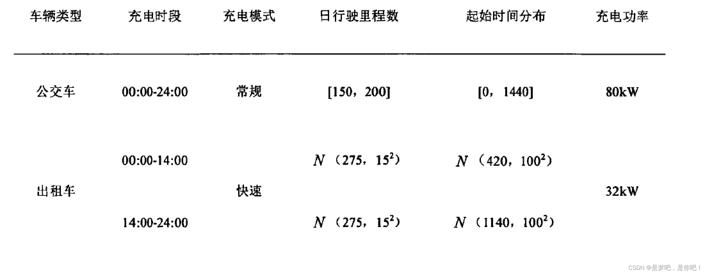
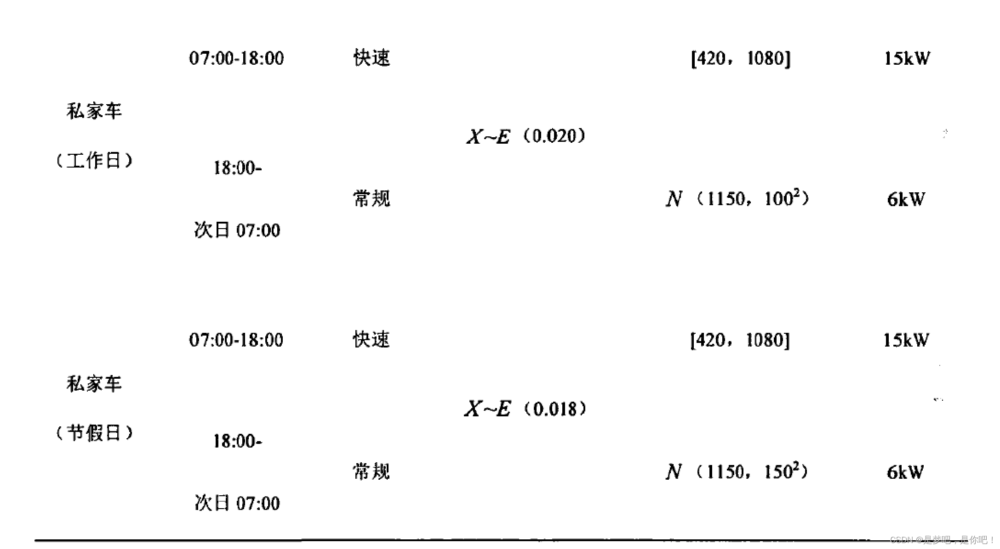
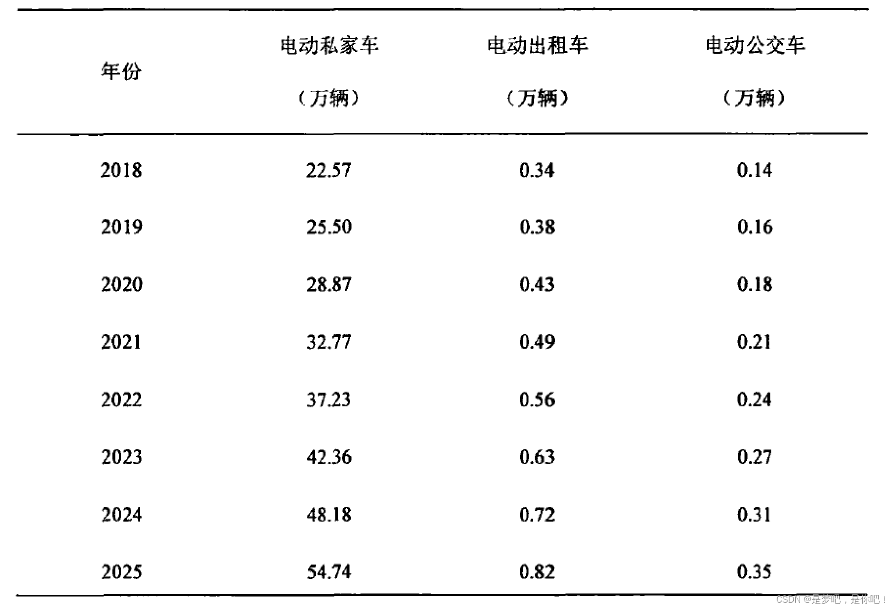

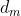
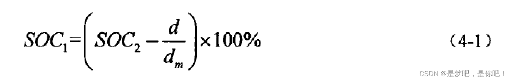
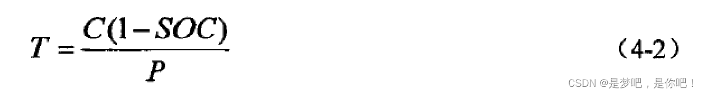
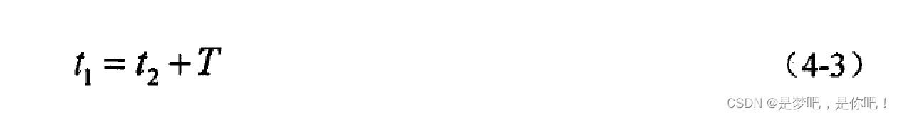
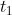
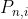
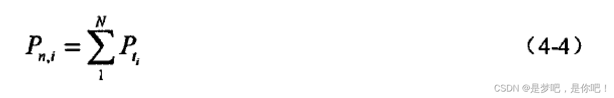
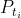
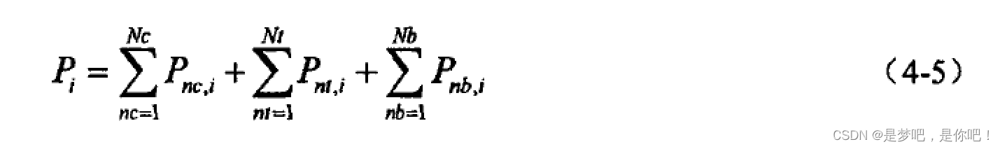
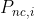
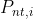
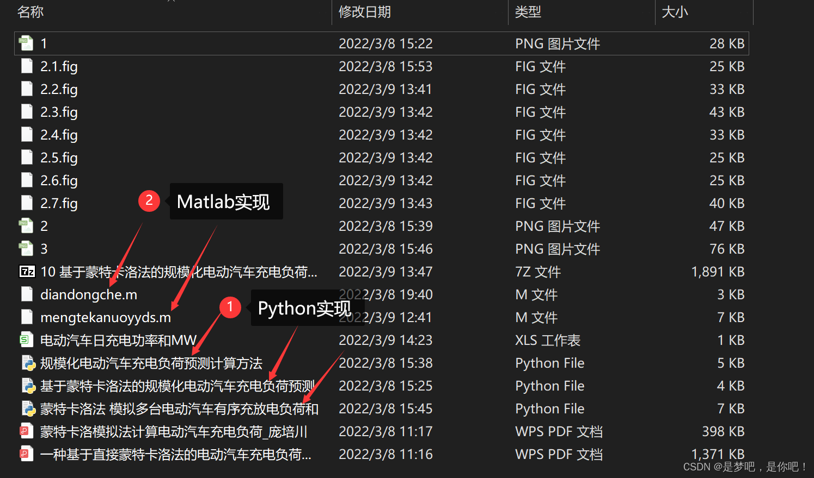
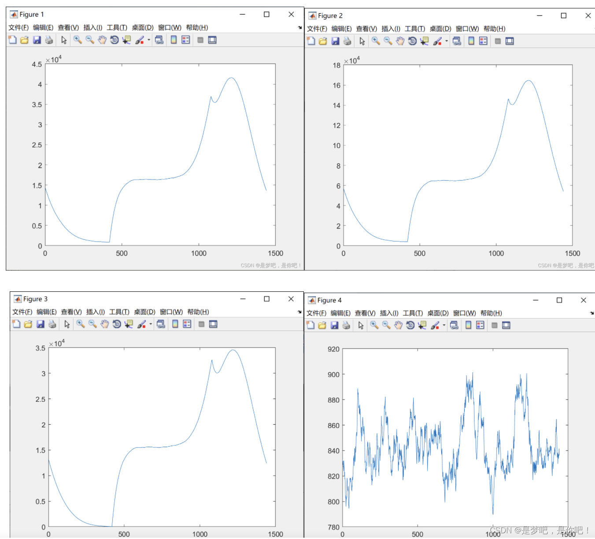

<!-- PAYMENT_BLOCK -->

## Get this dataset

- Payment link (Stripe): [Buy now](https://buy.stripe.com/3cs8yP7sY87d0vu9AB)
- Payment QR code: 

<!-- /PAYMENT_BLOCK -->
